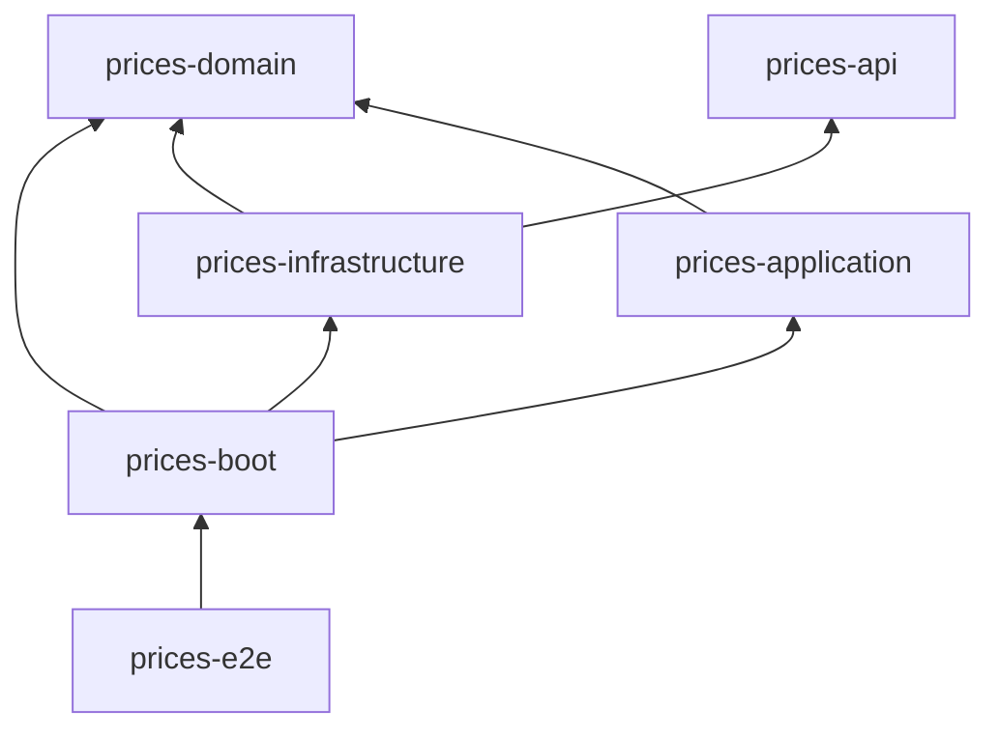

# Prices service

Spring Boot service that returns the final price applicable to a product of a brand at a given date.
When several price lists overlap, the one with the highest priority wins.

## Requirements

- Java 17+
- Maven 3.9+
- Docker (optional)

## Run

```bash
mvn clean install
java -jar prices-boot/target/prices-boot-1.0.0-SNAPSHOT-exec.jar
```

Or with Docker:

```bash
docker build -t prices-service .
docker run --rm -p 8080:8080 prices-service
```

The service starts on `http://localhost:8080` with an in-memory H2 database loaded with the sample data.

## API

```
GET /prices?applicationDate=2020-06-14T10:00:00&productId=35455&brandId=1
```

```json
{
  "productId": 35455,
  "brandId": 1,
  "priceList": 1,
  "startDate": "2020-06-14T00:00:00",
  "endDate": "2020-12-31T23:59:59",
  "price": 35.50,
  "currency": "EUR"
}
```

| Status | When |
|---|---|
| 200 | An applicable price exists |
| 400 | A parameter is missing or invalid (malformed date, non-numeric or lower than 1 identifier) |
| 404 | No price applies to the product of the brand at that date |

Errors follow RFC 9457 (`application/problem+json`).

- Contract (API-first): [`prices-api/src/main/resources/openapi/prices-api.yaml`](prices-api/src/main/resources/openapi/prices-api.yaml)
- Swagger UI: http://localhost:8080/swagger-ui.html
- Postman: import [`postman/prices-api.postman_collection.json`](postman/prices-api.postman_collection.json) (variable `baseUrl`, default `http://localhost:8080`).
  It contains the five statement cases and the error cases, with assertions. It can also run from the CLI:
  `npx newman run postman/prices-api.postman_collection.json`

## Tests

```bash
mvn verify
```

Runs every test of every module:

| Type | Location | Tooling |
|---|---|---|
| Unit | `prices-domain`, `prices-application`, `prices-infrastructure`, `prices-boot` | JUnit 5, Mockito, AssertJ, `@WebMvcTest`, `@DataJpaTest`, `@SpringBootTest` (wiring) |
| End-to-end | `prices-e2e/src/test/resources/features/prices.feature` | Cucumber, RestAssured |

The end-to-end suite covers the five requested scenarios (Test 1 to Test 5), prices not found and invalid requests.
By default it starts the application on a random port. To run the same scenarios against an already running instance
(for example the Docker container):

```bash
mvn install -DskipTests
mvn -pl prices-e2e test -Dprices.base-url=http://localhost:8080
```

Reports:

- Cucumber: `prices-e2e/target/cucumber-reports/cucumber.html`
- Coverage per module: `<module>/target/site/jacoco/index.html` (the build fails below 90% line coverage)
- Aggregated coverage: `prices-e2e/target/site/jacoco-aggregate/index.html`

## Architecture

Hexagonal architecture with a domain-driven design, split into Maven modules so dependency rules are enforced by the compiler:



| Module | Content |
|---|---|
| `prices-domain` | `Price` model, `PriceNotFoundException`, `GetApplicablePriceUseCase` input port and `PriceRepository` output port. Plain Java |
| `prices-application` | `GetApplicablePriceUseCaseImpl`, the use case implementation. Plain Java |
| `prices-api` | OpenAPI contract; `PricesApi` interface and `PriceResponse` DTO are generated at build time |
| `prices-infrastructure` | REST adapter (`PriceController`, `RestExceptionHandler`, `PriceResponseMapper`), JPA adapter (`PriceRepositoryAdapter`, `PriceEntityMapper`), H2 schema/data |
| `prices-boot` | Composition root: `PricesApplication`, `UseCaseConfiguration`, `application.yml`; builds the executable jar |
| `prices-e2e` | Cucumber end-to-end tests and aggregated coverage report |

### Notable decisions

- Both ports are defined in the domain; the application layer only holds the use case implementation.
- The priority rule is part of the output port contract (`PriceRepository#findApplicable`). The JPA adapter resolves it in the database with
  a derived `findFirstBy...OrderByPriorityDesc` query, so only the applicable row is read.
- Domain and application have no framework dependency; the use case is wired as a bean in `UseCaseConfiguration`, inside the dedicated
  `prices-boot` module. Adapters depend on the domain ports only, never on the application module.
- The JPA entity and the API DTO are separate from the domain model. Each adapter has its own MapStruct mapper: `PriceEntityMapper`
  (entity to domain) and `PriceResponseMapper` (domain to response). Schema and data are explicit SQL scripts (`schema.sql`, `data.sql`); `BRANDS` exists to keep
  `BRAND_ID` as a foreign key, as stated.
- Prices are `DECIMAL`/`BigDecimal`; dates are local date-times (ISO-8601) because the source data has no time zone; range bounds are inclusive.
- Swagger UI serves the contract YAML itself, so the documentation cannot drift from it.

Architecture decision records with diagrams are in [`docs/adr`](docs/adr):

1. [Hexagonal architecture and DDD](docs/adr/0001-hexagonal-architecture-and-ddd.md)
2. [API-first with OpenAPI](docs/adr/0002-api-first-with-openapi.md)
3. [Persistence with Spring Data JPA and H2](docs/adr/0003-persistence-with-spring-data-jpa-and-h2.md)
4. [Error handling with Problem Details](docs/adr/0004-error-handling-with-problem-details.md)
5. [Testing strategy](docs/adr/0005-testing-strategy.md)

## Tech stack

Java 17, Spring Boot 4.1, Spring Data JPA, H2, MapStruct, OpenAPI Generator, springdoc, JUnit 5, Mockito, Cucumber, RestAssured, JaCoCo, Docker.
