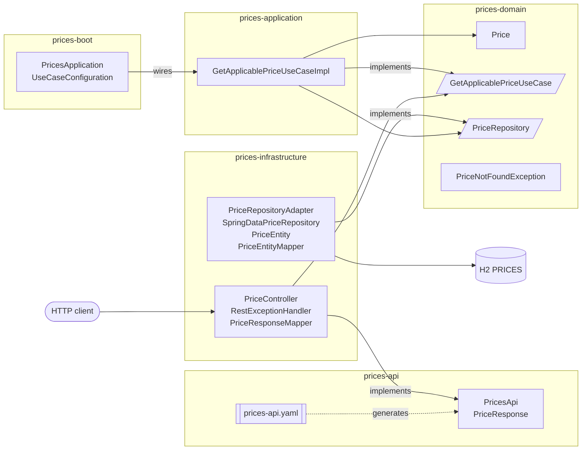
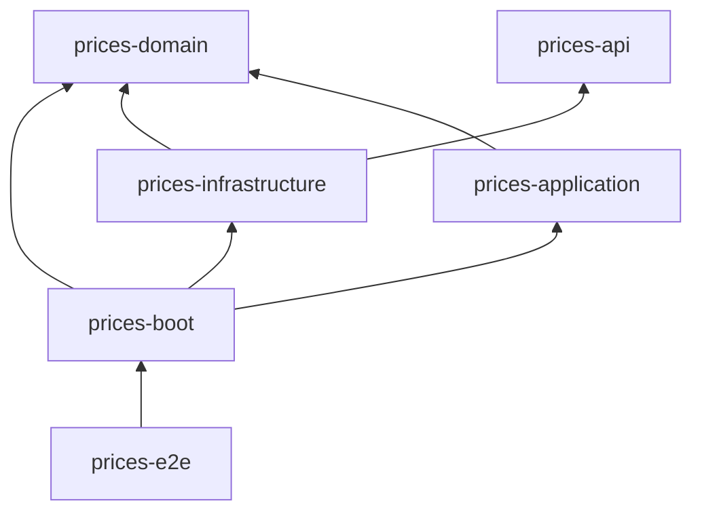

# ADR-0001: Hexagonal architecture with a domain-driven, multi-module layout

- Status: Accepted
- Date: 2026-10-19

## Context

The service answers a single business question: *which price applies to a product of a brand at a given moment?*
The assessment values a clear and clean structure based on hexagonal architecture, minimal code and no dead code.
Project guidelines require domain-driven design and hexagonal architecture.

## Decision

The core (domain + application) is isolated from technical concerns (HTTP, persistence, Spring), which only appear as adapters.
Boundaries are enforced by Maven modules, so a forbidden dependency is a compilation error rather than a convention.

| Module | Responsibility | Depends on |
|---|---|---|
| `prices-domain` | Ubiquitous language: `Price` model, `PriceNotFoundException`, input port `GetApplicablePriceUseCase` and output port `PriceRepository` | nothing (plain Java) |
| `prices-application` | Use case implementation `GetApplicablePriceUseCaseImpl` | domain |
| `prices-api` | OpenAPI contract and the interface/DTOs generated from it (see ADR-0002) | Spring Web annotations only |
| `prices-infrastructure` | REST input adapter and JPA output adapter | domain, api |
| `prices-boot` | Spring Boot entry point (`PricesApplication`), wiring (`UseCaseConfiguration`), runtime configuration; builds the executable jar | domain, application, infrastructure |
| `prices-e2e` | Cucumber end-to-end acceptance tests and aggregated coverage (see ADR-0005) | domain, application, infrastructure, boot |

### Domain modelling

- `Price` is a Java record holding brand, product, price list (tarifa), validity range, priority, amount and currency.
- The domain owns both ports: `GetApplicablePriceUseCase` (input) states what the hexagon offers and `PriceRepository` (output) what it needs.
  The application layer only contains use case implementations, so adapters never depend on it to know a contract.
- The disambiguation rule ("when ranges overlap the highest priority wins") is part of the output port contract:
  `PriceRepository#findApplicable` returns the single applicable price. The JPA adapter fulfils it in the database (ADR-0003), so only one
  row travels instead of every candidate being loaded and filtered in memory.
- The use case implementation is named after the port it implements (`GetApplicablePriceUseCaseImpl`) instead of the generic `Service` suffix.
- Brand and product identifiers stay as `Long`; wrapping them in value objects would add code without adding behaviour.

### Framework independence

Domain and application have no Spring dependency. The use case is exposed as a bean by `UseCaseConfiguration`.

Adapters only talk to the hexagon through the ports defined in the domain, so `prices-infrastructure` depends directly on `prices-domain` and
not on `prices-application`: adapters cannot reach use case implementations, only their contracts.

Bootstrapping and wiring live in their own module, `prices-boot`, the composition root. It is the only module that knows every other one:
it starts Spring Boot, instantiates `GetApplicablePriceUseCaseImpl` with the `PriceRepository` adapter, holds the runtime configuration
(`application.yml`) and packages the executable jar used by Docker. Infrastructure tests bootstrap their Spring slices with a test-only
`@SpringBootApplication`, so the adapter module does not need the real entry point.

### Mappers

Each adapter owns its translation, with a single responsibility, generated by MapStruct at compile time:

| Mapper | Adapter | Conversion |
|---|---|---|
| `PriceResponseMapper` | REST (input) | domain `Price` to API `PriceResponse` |
| `PriceEntityMapper` | persistence (output) | `PriceEntity` to domain `Price` |

## Consequences

- Business logic is unit tested without Spring context, fast and isolated.
- Swapping H2/JPA or the REST layer only touches `prices-infrastructure`.
- Six modules add some build configuration compared to a single module; this is accepted to make the hexagon explicit and compiler-enforced.
- Rest and persistence adapters share one module because each holds only a few classes; splitting them further would not pay off.
- A dedicated composition root keeps adapters decoupled from use case implementations; replacing the wiring or the runtime configuration does
  not touch adapters.
