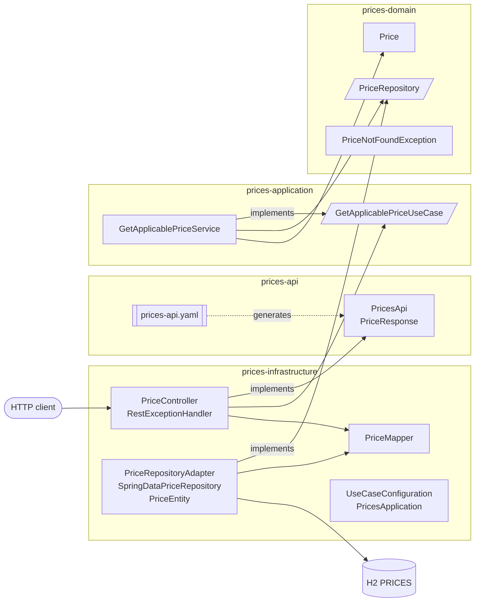
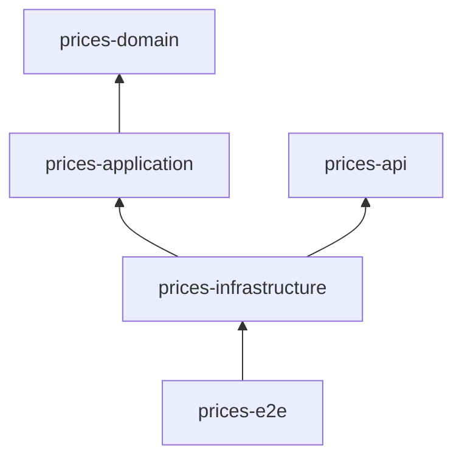

# ADR-0001: Hexagonal architecture with a domain-driven, multi-module layout

- Status: Accepted
- Date: 2026-10-19

## Context

The service answers a single business question: *which price applies to a product of a brand at a given moment?*
The assessment values a clear and clean structure based on hexagonal architecture, minimal code and no dead code.
Project guidelines require domain-driven design and hexagonal architecture.

## Decision

The core (domain + application) is isolated from technical concerns (HTTP, persistence, Spring), which only appear as adapters.
Boundaries are enforced by Maven modules, so a forbidden dependency is a compilation error rather than a convention.

| Module | Responsibility | Depends on |
|---|---|---|
| `prices-domain` | Ubiquitous language: `Price` aggregate, precedence rule, `PriceRepository` output port, `PriceNotFoundException` | nothing (plain Java) |
| `prices-application` | Use case `GetApplicablePriceUseCase` (input port) and its orchestration service | domain |
| `prices-api` | OpenAPI contract and the interface/DTOs generated from it (see ADR-0002) | Spring Web annotations only |
| `prices-infrastructure` | REST input adapter, JPA output adapter, Spring Boot bootstrap and wiring | application, api |
| `prices-e2e` | Cucumber end-to-end acceptance tests and aggregated coverage (see ADR-0005) | domain, application, infrastructure |

### Domain modelling

- `Price` is a Java record holding brand, product, price list (tarifa), validity range, priority, amount and currency.
- The disambiguation rule ("when ranges overlap the highest priority wins") is a business rule, so it lives in the domain as `Price#hasPrecedenceOver`.
  The output port only returns the candidates valid at the requested date, and the use case applies the domain rule.
- Brand and product identifiers stay as `Long`; wrapping them in value objects would add code without adding behaviour.

### Framework independence

Domain and application have no Spring dependency. The use case is exposed as a bean by `UseCaseConfiguration` in the infrastructure module,
which is the only place that knows about the framework.

## Consequences

- Business logic is unit tested without Spring context, fast and isolated.
- Swapping H2/JPA or the REST layer only touches `prices-infrastructure`.
- Five modules add some build configuration compared to a single module; this is accepted to make the hexagon explicit and compiler-enforced.
- Rest and persistence adapters share one module because each holds only a few classes; splitting them further would not pay off.
