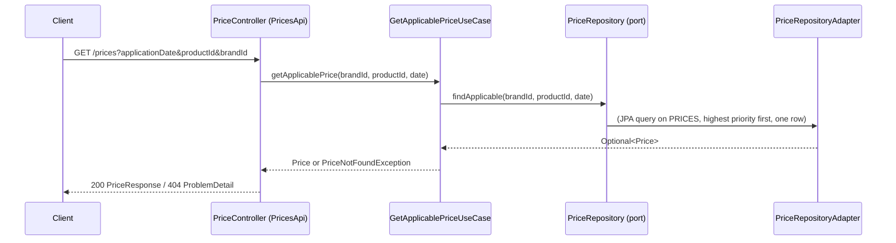

# ADR-0002: API-first contract with OpenAPI

- Status: Accepted
- Date: 2026-10-19

## Context

Consumers need a stable, documented contract. The assessment values API-first. The contract is an infrastructure concern for the hexagon,
but it is also a deliverable that other teams could depend on independently of the implementation.

## Decision

- The contract `prices-api/src/main/resources/openapi/prices-api.yaml` (OpenAPI 3) is written before the implementation and is the single source of truth.
- `openapi-generator-maven-plugin` (`spring` generator, `interfaceOnly`) generates the `PricesApi` interface and the `PriceResponse` DTO at build time.
  Generated code is never committed nor edited.
- `PriceController` (REST input adapter) implements `PricesApi` and translates between DTOs and the use case.
- Swagger UI (springdoc) renders the very same YAML file, so the published documentation cannot drift from the contract.

### Endpoint

```
GET /prices?applicationDate=2020-06-14T10:00:00&productId=35455&brandId=1
```

| Parameter | Type | Rule |
|---|---|---|
| `applicationDate` | ISO-8601 local date-time | required |
| `productId` | int64 | required, >= 1 |
| `brandId` | int64 | required, >= 1 |

Response `200`:

```json
{
  "productId": 35455,
  "brandId": 1,
  "priceList": 1,
  "startDate": "2020-06-14T00:00:00",
  "endDate": "2020-12-31T23:59:59",
  "price": 35.50,
  "currency": "EUR"
}
```

Errors are `application/problem+json` (ADR-0004): `400` invalid or missing parameters, `404` no applicable price.

Query parameters with `GET` are used because the operation is a safe, idempotent, cacheable lookup.
Dates are local date-times because the source data has no time zone.



## Consequences

- Contract changes are explicit and reviewed in the YAML; implementation breaks at compile time if it diverges.
- Generated sources are configured to avoid unnecessary libraries (no Swagger annotations, no nullable module).
