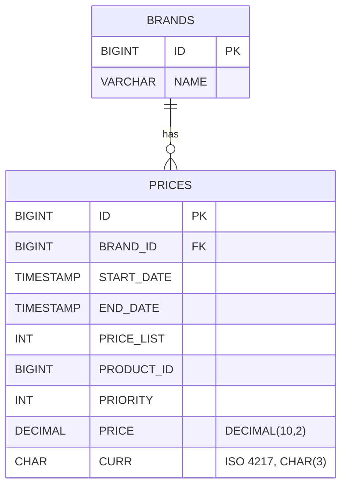

# ADR-0003: Persistence with Spring Data JPA over an in-memory H2 database

- Status: Accepted
- Date: 2026-10-19

## Context

The statement requires an in-memory database (H2) initialised with the sample data. Field names and types may be adapted.

## Decision

- H2 in-memory database, schema and seed data loaded by Spring SQL initialisation (`schema.sql`, `data.sql`); Hibernate DDL generation is disabled
  so the schema is explicit and reviewable.
- Spring Data JPA implements the output adapter (`PriceRepositoryAdapter` implements the domain `PriceRepository` port).
- `PriceEntity` is a persistence model distinct from the domain `Price`, so JPA annotations never reach the domain. The conversion is done by
  `PriceEntityMapper`, a MapStruct interface whose implementation is generated at compile time: no hand-written mapping code and no reflection at runtime.
- The adapter fulfils the `PriceRepository#findApplicable` contract (ADR-0001) with a Spring Data derived query, so the database returns only the
  applicable row instead of every candidate being filtered in memory:

  ```java
  Optional<PriceEntity> findFirstByBrandIdAndProductIdAndStartDateLessThanEqualAndEndDateGreaterThanEqualOrderByPriorityDesc(
          Long brandId, Long productId, LocalDateTime startDate, LocalDateTime endDate);
  ```

  which Hibernate translates to `... where brand_id=? and product_id=? and start_date<=? and end_date>=? order by priority desc fetch first 1 rows only`.
  The application date is passed as both range bounds. A derived query is preferred over JPQL because Spring Data validates it at startup and
  it needs no query string.



### Type choices

| Column | Type | Reason |
|---|---|---|
| `ID` | `BIGINT` identity | the sample rows have no natural key |
| `START_DATE`, `END_DATE` | `TIMESTAMP` | local date-times, inclusive bounds |
| `PRICE` | `DECIMAL(10,2)` | monetary amounts must not use floating point |
| `CURR` | `CHAR(3)` | ISO 4217 code |
| `BRAND_ID` | `BIGINT` FK to `BRANDS` | the statement defines it as a foreign key (1 = ZARA) |

An index on `(BRAND_ID, PRODUCT_ID, START_DATE, END_DATE)` supports the only query.

## Consequences

- Spring Data JPA gives a declarative query with very little code; JPA is heavier than plain JDBC but is the de-facto standard and easy to replace behind the port.
- `BRANDS` exists only to honour the foreign key; it has no entity because no use case needs it.
