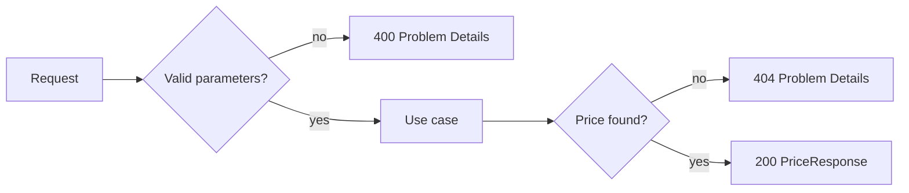

# ADR-0004: Error handling with RFC 9457 Problem Details

- Status: Accepted
- Date: 2026-10-19

## Context

The service must handle a missing applicable price and incorrect parameters explicitly, with consistent responses.

## Decision

- The domain signals the absence of an applicable price with `PriceNotFoundException`, without HTTP knowledge.
- A single `@RestControllerAdvice` (`RestExceptionHandler`, extending Spring's `ResponseEntityExceptionHandler`) translates errors to
  `application/problem+json` bodies using Spring's `ProblemDetail`.

| Situation | Exception | Status |
|---|---|---|
| No price valid for brand/product/date | `PriceNotFoundException` | 404 |
| Missing parameter | `MissingServletRequestParameterException` | 400 |
| Malformed date or non-numeric id | `MethodArgumentTypeMismatchException` | 400 |
| Id lower than 1 | `ConstraintViolationException` (bean validation from the contract) | 400 |

## Consequences

- Clients receive a standard, machine-readable error format documented in the OpenAPI contract.
- Validation rules are declared once in the contract and enforced by generated bean-validation annotations.
