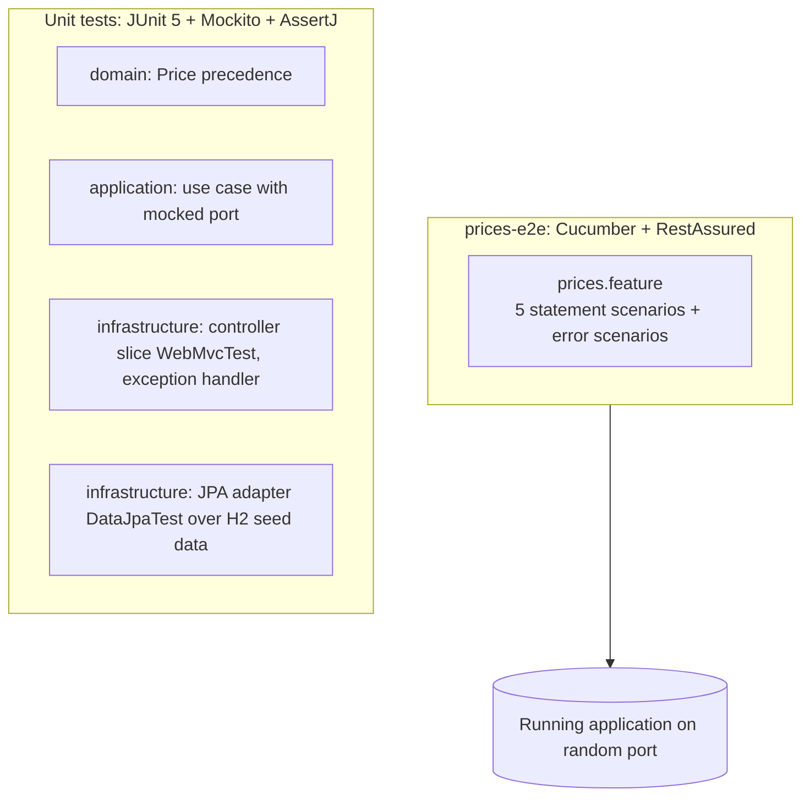

# ADR-0005: Testing strategy

- Status: Accepted
- Date: 2026-10-19

## Context

The statement asks for five functional scenarios against the REST endpoint. Guidelines require JUnit unit tests with at least 90% coverage
and end-to-end tests with Cucumber.

## Decision

- **Unit tests** live in each module and are executed by Surefire. Domain and application tests are pure JUnit; adapters use Spring test slices
  limited to the adapter under test.
- **End-to-end tests** live in `prices-e2e`, written in Gherkin and executed with Cucumber on the JUnit Platform. Steps use RestAssured against the
  real HTTP endpoint with the real H2 data. By default the application is started in-process on a random port; setting `-Dprices.base-url=...`
  points the same scenarios to any running instance (for example, the Docker container).
- **Coverage**: JaCoCo `check` fails each hand-written module below 90% line coverage. Generated code (`prices-api`) and the Spring Boot
  `main` class are excluded. An aggregated report of all tests is produced in `prices-e2e/target/site/jacoco-aggregate`.
- A Postman collection with the same scenarios allows manual exploration.

## Consequences

- The five required cases are executable specifications readable by non-developers.
- The application must be built before the e2e module, which Maven reactor ordering guarantees.
